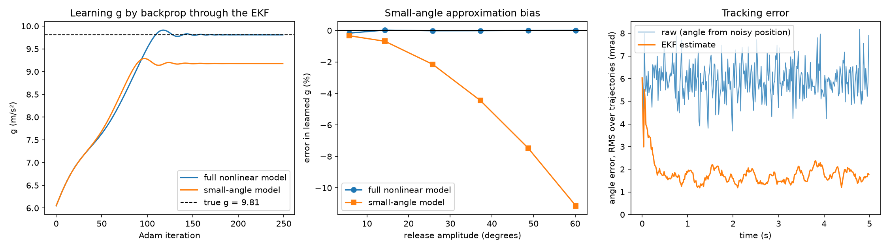
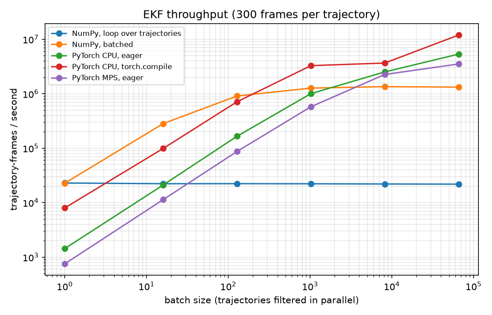

# diffkalman

**A batched, differentiable Extended Kalman Filter in PyTorch that learns physical constants by backpropagating through the filter.**

It grew out of my OpenCV pendulum tracker, which used a hand-tuned NumPy Kalman filter to recover *g* from video. Here the filter is rebuilt in PyTorch so that:

- **The physics is learned, not hand-tuned.** The filter's log-likelihood is differentiable, so gradient descent fits *g*, damping, process noise and measurement noise directly from noisy position tracks.
- **Thousands of trajectories are filtered in parallel** on CPU, Apple MPS or CUDA with the same code.
- **New models need no hand-derived Jacobians.** `torch.func.vmap(jacrev(f))` supplies them, checked against a hand-derived RK4 Jacobian to 1e-12.



## Results

All numbers come from synthetic data with known ground truth: 32 trajectories, 5 s of 60 fps "video", a 0.5 m pendulum released at 29–57°, and 3 mm position noise (a couple of pixels). Reproduce them with `uv run python scripts/fit_g.py`.

| parameter | true | learned |
|---|---:|---:|
| g (m/s²) | 9.81 | **9.808** (−0.02%) |
| damping (1/s) | 0.080 | 0.079 |
| measurement noise σ (mm) | 3.0 | 2.98 |

- **3.1× lower angle error** than the raw measurements (1.9 vs 6.0 mrad RMS).
- **The small-angle approximation is measurably wrong.** The textbook model (sin θ ≈ θ, the source of T = 2π√(L/g)) fits the same data with *g* biased low, by 6.4% on this dataset and by 11% at a 60° release. Theory predicts roughly −θ₀²/8. The full nonlinear model stays within 0.2% at every amplitude (middle panel above).
- Fitting takes 250 Adam steps, about 30 s on a laptop CPU including the one-time `torch.compile`.

## Performance



The benchmark measures throughput in trajectory-frames per second, for forward filtering only. Machine: Apple M4 Pro, torch 2.14.1. Reproduce with `uv run python scripts/bench.py`.

| method | B=1 | B=128 | B=8192 | B=65536 |
|---|---:|---:|---:|---:|
| NumPy, loop over trajectories | 22,960 | 22,321 | 22,032 | 21,874 |
| NumPy, batched | 22,725 | 910,031 | 1,350,227 | 1,322,803 |
| PyTorch CPU, eager | 1,432 | 165,579 | 2,514,988 | 5,337,282 |
| PyTorch CPU, `torch.compile` | 8,009 | 712,410 | 3,661,136 | **11,953,544** |
| PyTorch MPS (Apple GPU), eager | 752 | 87,100 | 2,258,199 | 3,519,772 |

What I learned from profiling:

1. **A hidden GPU→CPU sync made the GPU 50× slower than it should be.** At first MPS ran at only 45,890 traj-frames/s at B=8192, and its time per step *grew* with batch size, which is not what launch overhead looks like. `torch.profiler` put 77% of the time in `aten::_local_scalar_dense`, reached through `linalg_cholesky → _linalg_check_errors → item()`. The error check copies a status flag back to the host and stalls the GPU queue every step. The next hotspot was `cholesky_solve`, whose batched triangular solve takes 45 ms on MPS at B=4096 (a batched matmul takes 0.06 ms). Switching to `cholesky_ex` (log-det only) plus a single `linalg.solve_ex` for both right-hand sides made MPS **49× faster** (2.26M traj-frames/s). The trade-off is that a non-positive-definite S now produces NaN instead of an exception.
2. **Small matrices are dispatch-bound, not compute-bound.** Each time step is about 40 ops on batches of 2×2 matrices, and the time loop is inherently sequential. `torch.compile` fuses each step, which cuts a training iteration (forward + backward, B=32) from 424 ms to **81 ms**.
3. **Vectorization comes first, then hardware.** Batching alone is worth 60× over the per-trajectory loop (NumPy batched vs loop). On this machine the integrated GPU never overtakes a 14-core CPU for 2×2 matrices, even at 65k trajectories. Where the GPU pays off depends on the hardware, so measure it rather than assume it.

**Run it on an NVIDIA GPU (free Colab T4):**

```python
!git clone https://github.com/timothyzhbw-jpg/diffkalman && cd diffkalman && pip install -q -e . && python scripts/bench.py
```

The benchmark adds CUDA rows automatically when `torch.cuda.is_available()`.

## How it works

`diffkalman/ekf.py` is about 90 lines. Each time step runs an update followed by a predict, vectorized over the batch:

```
H = ∂h/∂x (autograd)     y = z_t − h(x)          S = H P Hᵀ + R
K = P Hᵀ S⁻¹             x ← x + K y             P ← (I−KH) P (I−KH)ᵀ + K R Kᵀ   (Joseph form)
log p(z_t | z_<t) = log N(y; 0, S)
F = ∂f/∂x (autograd)     x ← f(x)                P ← F P Fᵀ + Q
```

The training loss is the negative sum of the per-step log-likelihoods (the *prediction-error decomposition*). A wrong *g* makes every one-step prediction drift, which inflates the innovations y and so the loss, and autograd carries that signal back to *g* through every step.

The model (`diffkalman/pendulum.py`) has state [θ, ω], uses RK4 dynamics with damping, and measures the bob position L·(sin θ, −cos θ). Positive parameters are learned in log space.

## Tests

```bash
uv sync && uv run pytest
```

| test | checks |
|---|---|
| `test_autograd_jacobian_matches_hand_derived_rk4_jacobian` | `torch.func` Jacobian vs chain rule through RK4 stages, to 1e-12 |
| `test_matches_numpy_reference` | means, covariances and log-likelihood vs an independent NumPy EKF |
| `test_log_likelihood_gradients_are_correct` | `torch.autograd.gradcheck` (float64 finite differences) on *g* and both noise levels |
| `test_filter_beats_raw_measurements` | the EKF at least halves the raw angle error |
| `test_compiled_matches_eager` | `torch.compile` gives identical outputs and gradients |
| `test_mps_matches_cpu` | the Apple GPU matches the CPU (skipped elsewhere) |

## Limitations and next steps

- Results so far are on synthetic data, where the ground truth is known. The next step is the real tracks from my OpenCV tracker.
- `torch.compile` on MPS fails in torch 2.14.1 with an inductor stride assertion, so only CPU compile numbers are reported.
- **Parallel-in-time filtering.** The Kalman recursion can be written as an associative operator ([Särkkä & García-Fernández, 2021](https://arxiv.org/abs/1905.13002)), so a prefix scan would cut the sequential depth from O(T) to O(log T). That is the natural way to use a GPU when batches are small.
- CUDA Graphs, to remove per-step launch overhead on NVIDIA GPUs.
